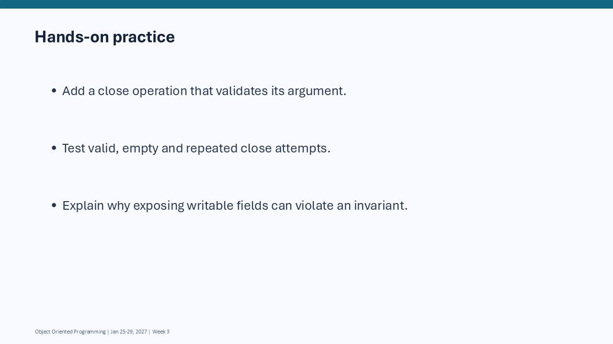

# C# examples: weeks 1-6

These original examples use .NET 10 and the same service-request theme as the
course's JavaScript examples. From the course repository root, run:

```powershell
dotnet run --project CSharp -- 3
dotnet run --project CSharp -- self-test
```

Replace `3` with a week from 1 through 6. The examples cover object modeling,
independent instances, encapsulation, polymorphism, composition and
validation. See the [course README](../README.md) for SDK setup and the
weekly textbook links.

The week 3 slide below shows the related practice prompt; the program's week 3
example closes a request after validating its resolution.


